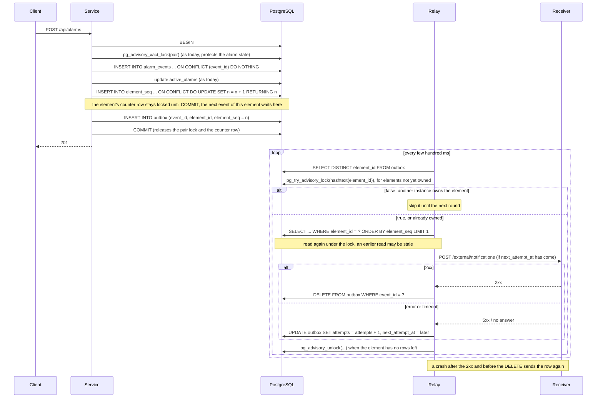

# Telecom Alarm Notification Service

A Spring Boot service that receives alarm events from (simulated) mobile network elements, stores every unique
accepted event as history in PostgreSQL, keeps the set of active (not cleared) alarms, and sends an asynchronous
HTTPS notification for every accepted event to an external endpoint.

Everything in the assignment is implemented, the optional parts included: the history API with filtering and
pagination, and the asynchronous notifications (with a mock receiver for a local run). The assignment also asks
to describe how notifications could survive crashes and keep their order across several instances; that design is
in [Design: durable notifications and ordering across instances](#design-durable-notifications-and-ordering-across-instances).

## Contents

- [Assumptions](#assumptions)
- [Design decisions](#design-decisions)
- [Concurrency guarantees](#concurrency-guarantees)
- [What can be lost on a crash or shutdown](#what-can-be-lost-on-a-crash-or-shutdown)
- [Known limitations](#known-limitations)
- [Technology](#technology)
- [How to run](#how-to-run)
- [API and sample requests](#api-and-sample-requests)
- [Tests](#tests)
- [Design: durable notifications and ordering across instances](#design-durable-notifications-and-ordering-across-instances)
- [Use of AI tools and external solutions](#use-of-ai-tools-and-external-solutions)

## Assumptions

The assignment leaves some behaviour open. Below are the rules I chose to fill the gaps; the code implements them, and
parts of it make sense only if you know them. Each rule has its reason. They are numbered, so the rest of this README
can refer to them.

### Events and validation

**A1. All fields are mandatory except `description`.**
The assignment does not say which fields are mandatory. A field is mandatory when some feature needs it: `eventId` for
duplicate detection, `elementId` and `alarmCode` for the alarm identity, `severity` for statistics, `status` and
`timestamp` for the alarm state. No feature uses `description`.

**A2. Unknown JSON fields are ignored.**
A sender can add new fields without breaking the service.

**A3. `severity` and `status` must be one of the listed names; a number is rejected (400).**

**A4. `timestamp` is the time of the event on the network element, not the time it reached the service.**
It is stored and returned exactly as received (epoch milliseconds).

**A5. A `timestamp` more than 5 minutes after the server's time is rejected (400), and so is a negative one.**
By B1 the latest event wins, so one event dated a year ahead would hide every real event of its alarm for a year.
5 minutes covers the normal clock difference between a device and the server; the value is configurable.

**A6. Ids are at most 64 characters, `description` at most 1024.**
The same limits as the database columns, so a value that is too long gets a 400 and never causes a database error.

### Alarm state

**B1. Between the events of one alarm, the last (by `timestamp`) wins, not last arrived.**
The network can delay events and devices resend them, so events arrive out of order. If the last arrival won, a RAISED
that arrives late, after its CLEARED, would make an alarm that is really cleared active again.

**B2. On equal timestamps: RAISED beats CLEARED; between two RAISED, the higher severity wins; otherwise the greater
`eventId`.**
Equal timestamps are normal: many devices report time in whole seconds. A missed alarm is worse than a false one, so
RAISED and the higher severity win. The `eventId` rule means nothing in the domain; it only makes the result the same
for any arrival order.

**B3. An older event is still accepted (201) and stored in history, but it does not change the active state.**
It is a valid, real event, and the assignment wants every accepted event in history. Rejecting it would also break the
check "a valid event is stored".

**B4. "CLEARED for an unknown alarm" means: the alarm has no accepted RAISED earlier than this CLEARED. Such a CLEARED
gets 409.**
- A CLEARED of an alarm that was raised and is already cleared is accepted and changes nothing: devices resend clears,
  for example after a reboot, and this is not an error.
- "Earlier than this CLEARED", not "ever": by B1 a CLEARED that is older than every RAISED of its alarm has nothing to
  clear. With this definition the answer also does not depend on the arrival order.

> [!IMPORTANT]
> **B5. A rejected CLEARED is still stored (as REJECTED), and it is brought back when its RAISED arrives
> ("resurrection").**
>
> This rule is not in the assignment, and it explains a part of the code that looks unusual: rejected events are
> stored, and an accepted RAISED can change rows stored earlier.
>
> **The problem.** RAISED at 10:00, CLEARED at 10:05, but the CLEARED arrives first. By B4 it gets 409. If it were
> simply thrown away, the RAISED that arrives next would make the alarm active forever, although in reality it was
> cleared at 10:05.
>
> **The solution.**
> 1. The CLEARED is stored as REJECTED; the device gets 409.
> 2. When a RAISED is accepted, every REJECTED CLEARED of the same alarm that is later than the RAISED becomes
>    ACCEPTED, in the same transaction.
> 3. The state is computed again from the accepted events: the alarm ends up not active, as in reality.
>
> The 409 was the right answer at that moment. If the device sends the same `eventId` again after the resurrection,
> it is an exact repeat of an accepted event: 200.

**B6. REJECTED events are internal.**
They are not shown by `GET /history`, not used to compute the state, and a repeat of a rejected `eventId` gets 409
again.

### Duplicates

**C1. Senders deliver at least once: the same event may arrive more than once.**
A device that did not get the response sends the event again. A repeat is a normal case, not an error.

**C2. An exact repeat of an accepted event gets 200: nothing is written, no second notification. The same `eventId`
with any difference in the data gets 409.**
200 instead of 201 tells the client "already stored"; both mean success. A difference means two different events
share one id, which is a bug of the sender, and the service cannot know which one is right. The 409 does not reveal
the stored event.

### Notifications

> [!IMPORTANT]
> **D1. Every newly accepted event is notified, including older ones (B3) and resurrected ones (B5). Rejected events
> and repeats are not.**
>
> The assignment asks for a notification "for each newly accepted event". The rule is applied at the moment an event
> becomes accepted, and for a resurrected CLEARED (B5) that moment is the resurrection, not its arrival.
>
> **Why resurrected events are notified.** The RAISED (10:00) arrives one millisecond after its CLEARED (10:05). The
> CLEARED is rejected (B4), so no notification is sent for it. When the RAISED arrives, the CLEARED becomes accepted,
> right after the RAISED, so it is notified then. Without that, the receiver would get the RAISED and never the
> CLEARED, and would show an alarm that was already cleared, as active forever. With it, every accepted event is sent
> to the receiver once (best effort), so the receiver's history matches ours.
>
> The body is the event as received, not the alarm state: what the receiver does with it is unknown, and a receiver
> that needs the state can read `GET /api/alarms/active`.

> [!NOTE]
> **D2. Notifications of one element are sent in the order the service accepted the events (the order of their
> commits), not in `timestamp` order.**
>
> This is a different order from B1, on purpose. The state is decided by event time; a notification reports what the
> service accepted and when. Sending in `timestamp` order would mean holding notifications back to wait for late
> events, with no upper limit on the wait. A late event is notified when it arrives; its `timestamp` shows the receiver
> that it is old. When a RAISED resurrects CLEARED events (B5), the RAISED is notified first, then those CLEARED events
> in time order. For two requests of one element that arrive at the same time, the one that commits first is notified
> first.

**D3. A full notification buffer never rejects an alarm.**
The event is stored (201), its notification is dropped, the response says `"notification": "DROPPED_QUEUE_FULL"`, and a
warning is logged. The service's history and state are the source of truth; the notification is an optional extra.
Refusing alarms because an external monitor is slow would lose data, not just a notification.

### Environment

**E1. One database. The service may run as one or several instances.**
The state is correct with any number of instances. The notification order (D2) is guaranteed within one instance; the
assignment asks only to describe ordering across instances, see
[Design: durable notifications and ordering across instances](#design-durable-notifications-and-ordering-across-instances).

**E2. Device clocks are roughly in sync with the server.**
B1 trusts the device time; a clock that jumps back is a [known limitation](#the-ordering-policy-trusts-the-device-clock).

**E3. `elementId` values are real network elements, so their number is limited.**
For every element the service keeps a small notification queue (a few hundred bytes) and never removes it, so memory
grows with the number of different elements. For real equipment that is small; random ids sent by a client would
make it grow without limit (see [known limitations](#per-element-notification-queues-are-never-removed)).

## Design decisions

How the rules above are implemented, and why this way. Where a rule is described in [Assumptions](#assumptions), it
is referred to by its number.

### 1. Why PostgreSQL

> [!NOTE]
> PostgreSQL was chosen for two concurrency needs of the design: a duplicate that is not an error, and a lock on an
> alarm that has no row yet. PostgreSQL solves each with one statement; MySQL / MariaDB only with workarounds.

The assignment allows MariaDB, MySQL or PostgreSQL.

**1.1 A repeated event must be a normal outcome, not an error (C1, C2).**
- PostgreSQL: `INSERT ... ON CONFLICT (event_id) DO NOTHING` returns 0 rows for a duplicate. The transaction goes on,
  so the service reads the stored row and answers 200 or 409 in the same transaction, with no exception.
- MySQL / MariaDB:
  - `INSERT ... ON DUPLICATE KEY UPDATE`: with the default driver settings the row count does not tell an insert from
    a duplicate. The fix (`useAffectedRows=true`) changes the meaning of row counts for the whole connection, Hibernate's
    own updates included.
  - `INSERT IGNORE`: ignores not only duplicates but other errors too; an invalid value is silently converted and stored.
  - Catching the duplicate-key error: every repeat goes through an exception and a new transaction, and parallel repeats
    of one key in InnoDB can end in a deadlock instead of a duplicate-key error.

**1.2 A lock on the alarm, even when the alarm has no row yet (B4, B5).**
Decisions about one alarm must run one at a time (see [Concurrency guarantees](#concurrency-guarantees)). The first
events of a new alarm have no row to lock, so `SELECT ... FOR UPDATE` locks nothing.
- PostgreSQL: `pg_advisory_xact_lock` locks a key chosen by the application (here the alarm's `elementId` and
  `alarmCode`), whether rows exist or not, and releases it by itself at commit or rollback.
- MySQL / MariaDB: `GET_LOCK()` locks a name, but the lock belongs to the connection, not to the transaction: commit
  and rollback do not release it. With a connection pool, one missed `RELEASE_LOCK` leaves the lock on a pooled
  connection. InnoDB gap locks on an empty index range do not help either: two transactions can hold the same gap lock,
  and when both insert, they deadlock.

### 2. Active alarms are a table next to the history

- **History** is the table `alarm_events`: one row per unique received event, with `event_id` as the primary key.
- **Active state** is the table `active_alarms`: one row per active alarm, and the row has a single column, `event_id`,
  a reference to the event that made the alarm active. Its fields come from a join with the history, so they are
  never stored twice and cannot drift apart.

Both tables are changed in **one transaction** per event. That gives, with one mechanism: history and state always
agree; the state survives a restart; and several application instances share one correct state (E1).

An in-memory state object (a `ConcurrentHashMap`) was considered. It needs a second write outside the database
transaction, so the two can disagree after a failure between the writes; it must be rebuilt from the history on every
start; and every instance would have its own copy. The table avoids all three. The assignment calls the state an
"object" and does not say where it lives; I read it as "kept separately from the history".

### 3. Duplicates: `INSERT ... ON CONFLICT DO NOTHING` (C2)

The history row is written with a native query:

```sql
INSERT INTO alarm_events (...) VALUES (...) ON CONFLICT (event_id) DO NOTHING
```

It returns 1 if the row was inserted and 0 if the `eventId` was already taken. On 0 the service reads the stored row
in the same transaction and compares all fields: equal and accepted means an exact repeat (200); anything else is a
409. The unique primary key decides, so two parallel requests with the same `eventId` cannot both insert: PostgreSQL
makes the second `INSERT` wait until the first transaction ends, and then it inserts nothing (0 rows). A test
reproduces exactly this wait, deterministically: `DuplicateInsertRaceTests` (see [Tests](#tests)).

Why not plain JPA: `save()` with an assigned id is a `merge`, which reads the row and can silently overwrite it.
`persist()` fails on the duplicate with a unique-constraint violation, and in PostgreSQL an error aborts the whole
transaction, so the stored row can no longer be read to tell a repeat from a conflict. "Check first, then insert" is a
race between the check and the insert. `ON CONFLICT DO NOTHING` has none of these problems.

Native SQL is used only where PostgreSQL offers what JPQL lacks: this insert, the resurrection update (decision 5)
and the advisory lock (decision 6.1). Everything else is Spring Data JPA.

### 4. One implementation of the event order (B1, B2)

The order of events of one alarm is written once, in Java: `AlarmEventComparator`. Any two different events compare
as different (event ids are unique), so the final state depends only on the set of accepted events, never on the order
in which they arrived.

SQL only narrows the candidates: it returns the accepted events at the latest timestamp of the alarm, and Java picks
one of them. The last tie-break compares `eventId` strings, and string order in SQL follows the database collation,
so it could differ from Java's; a second copy of the rule in SQL would also have to be kept equal to the first.

### 5. Rejected CLEARED events live in the history table (B4, B5, B6)

A rejected CLEARED is a normal history row with `acceptance = REJECTED`; no separate table. Resurrection is then one
native `UPDATE ... RETURNING` in the same transaction as the RAISED that causes it: it accepts the rejected CLEARED
events and returns them for the notifications in one statement, where JPA would need a select and then one update
per row. JPQL has no `RETURNING`.

The 409 for a rejected CLEARED is raised **after** the commit. Inside the transaction the exception would roll back
the REJECTED row, and then a later RAISED would have nothing to resurrect.

### 6. Concurrent requests: a lock per alarm in the database, a lock per element in the JVM

- **6.1 Per alarm:** a PostgreSQL advisory lock, taken as the first statement of the event transaction. All steps "read the
  history of the alarm, decide, write" of one alarm run one after another, also across instances.
- **6.2 Per element:** a JVM lock around the transaction, the commit and the queueing of the notifications. It gives the
  notification order D2 within one instance.

Details, and why not `SELECT ... FOR UPDATE`, are in [Concurrency guarantees](#concurrency-guarantees).

### 7. Validation and errors

- **7.1 Validation at the edge.** The request is checked with Bean Validation on `AlarmEventRequest` (plus one own
  annotation for the timestamp range, A5) before the service is called: an invalid request takes no lock, opens no
  transaction and never reaches the database.
- **7.2 `severity` and `status` are enums in the request type**, not strings checked later. The cost: an unknown value
  fails while the JSON is read, and the JSON reader stops at the first such error, so the client learns only about
  that one field; other errors in the same request are not reported. Accepted: the client is a program and cannot fix the request by itself; the full list
  would only help diagnosis.
- **7.3 One error format, RFC 9457 problem details** (`application/problem+json`), produced in one place
  (`ApiExceptionHandler`), instead of a home-made error JSON: a client handles 400, 409, 415 and 500 with one parser, and
  Spring supports the format natively. Validation errors add `errors: [{field, message}]`. No exception text, class
  name, SQL or stored data reaches the response, so errors reveal nothing about the internals or about other events.

### 8. Read API

- **8.1 Reads take no locks.** `/active`, `/elements/{elementId}` and `/statistics` read the active table joined with the history, one SQL query
  each. Under READ COMMITTED one query sees one snapshot, so a response is always consistent in itself. They take no
  locks, so they never wait for writers and writers never wait for them.
- **8.2 `spring.jpa.open-in-view: false`.** With the Spring Boot default, the Hibernate session stays open for the whole
  HTTP request, and a lazy association read in a controller silently runs one more `SELECT` per row (N+1). Turned off,
  such a mistake fails at once with `LazyInitializationException`; the queries that need the event fields of active
  alarms fetch them in the same query.
- **8.3 Keyset pagination.** `/history` uses keyset pagination: the next page is `WHERE (event_timestamp, event_id) > (cursor)` with
  `ORDER BY event_timestamp, event_id`. Each filter combination has an index "filter columns, then these two", so a
  page is read straight from the index. Unlike `OFFSET`, the cost of a page does not grow with its number, and new rows
  do not shift pages. The service asks for `limit + 1` rows to know whether a next page exists.
- **8.4 The history cursor is an opaque string, not an `eventId`.** `next` is base64url of `{"ts": <timestamp>, "id": "<eventId>"}`
  of the last row; the client only passes it back as `after`. Why not just `after=<eventId>`:
  - the page query needs both values; with only the id the server would first look up its timestamp, one more query
    per page;
  - the sort order or the cursor content can change later without breaking clients, which only pass the string back;
  - `after=EVT-10005` is easy to misread as "event ids greater than EVT-10005", while it means "after this row in the
    history order"; an opaque string gives nothing to misread.

  The cost: the cursor is not readable by eye; for debugging, decode the base64url.

  The cursor is read by its own strict JSON mapper: a cursor with unknown fields is a 400 (request bodies, in contrast, ignore unknown fields, A2), and
  changes to the API's `spring.jackson.*` settings do not change the format of cursors already given out.

### 9. Notifications

**How a notification travels**

1. The event's transaction commits.
2. Still holding the element's lock, the request thread puts the notification into that element's queue and returns
   the response. It never waits for the HTTP call.
3. A sender thread from a shared pool takes the element's queue and sends its notifications one by one, until the
   queue is empty.
4. After a 2xx answer the sender sets `notification_sent = true` on the event's row.

**Decisions**

- **9.1 Queue only after the commit.** An event that is rolled back never gets a notification, and a database
  transaction never waits for an HTTP call.
- **9.2 One queue per element, one shared pool of senders.** An element is served by one sender at a time, so its
  order is kept (D2); different elements are served by different senders in parallel. The hand-over between the request
  thread and the sender runs under a small lock on the element's queue, so a notification is never left in a queue with
  no sender. Rejected: a fixed set of N threads chosen by `hash(elementId) mod N` (one slow element holds back every
  other element on its thread).
- **9.3 Considered: Spring Integration `PartitionedChannel`.** It is the ready-made form of the design rejected in 9.2: a
  message goes to partition `hash(key) mod N`, and each partition has one thread. Against the requirements:
  - *Order per element:* yes, one partition, one thread.
  - *Different elements in parallel:* yes, but with weaker isolation. Each element is bound to one partition thread,
    so a slow or busy element delays the other elements of its partition even while other threads are idle (with
    N = 10, `BTS-100` and `BTS-119` share partition 9). Here a free sender serves any element.
  - *The request thread must not wait:* not with the default settings. `send()` waits until the partition's thread is
    free, and when the partition's queue is full the caller is blocked with no time limit (`CallerBlocksPolicy`). This
    can be fixed by configuration: a partition queue at least as large as our own `Semaphore` limit never fills, so
    `send()` never blocks.
  - *Shutdown with a deadline* (our decision, see 9.8): the channel's own stop has no bounded wait and no
    forced stop. A bounded wait can be built on our `Semaphore`, but sends still running after the deadline cannot be
    interrupted.

  Not taken: even configured, it keeps our `Semaphore`, the per-element lock and the shutdown logic, and replaces only
  the hand-over code (about 60 lines), at the cost of a dependency, its internals to explain, and weaker isolation
  between elements.
- **9.4 One limit for all queues together** (`queue-capacity`, a `Semaphore`). A notification takes a place when it is
  queued and gives it back after its send attempt. When there is no free place, the request does not wait: the
  notification is dropped (D3).
- **9.5 Delivery is recorded in the history row.** After a 2xx answer the sender sets `notification_sent = true`; after
  a failure, a drop (D3) or a crash it stays `false`. So the lost notifications can be found afterwards with one query
  instead of only in the logs. The POST comes first and the `UPDATE` second, so the flag can say less than what
  happened, never more (see [Known limitations](#notification_sent--false-does-not-mean-not-delivered)).
- **9.6 HTTPS, HTTP/1.1.** The JDK `HttpClient`, limited to HTTP/1.1: HTTP/2 brings nothing for one small POST per
  notification. The local receiver has a self-signed certificate for `localhost`, so tests and the manual run go
  through the same TLS handshake and host-name check as production would.
  The JDK client is chosen explicitly (`spring.http.clients.imperative.factory: jdk`). Without it Spring Boot picks the
  client by what is on the classpath, and WireMock brings Apache HttpClient into the tests: the tests would run on a
  different client than production, and the timeouts would be checked on the wrong one.
- **9.7 Sizes.** The assignment gives no load, so three inputs are assumed. All values are configurable; with real numbers,
  put them into the same formulas.

  | Input | Assumed | Meaning |
  |---|---|---|
  | notification rate | 100 per second | how many notifications arrive per second |
  | send time | 50 ms | how long one POST to a healthy receiver takes |
  | outage to survive | 30 s | how long the receiver may be down without losing notifications |

  - **`pool-size: 10`**: sender threads.
    ```
    sends in progress = notification rate × send time = 100/s × 0.05 s = 5
    pool-size         = sends in progress × 2 (margin for bursts and a slower receiver) = 10
    ```
    This is Little's law. A sender is busy for the whole send, so 5 sends at a time need 5 threads; with fewer, the
    buffer only grows. More threads would add parallel load on the receiver and on the database pool (each successful
    send runs one `UPDATE`).
  - **`queue-capacity: 3000`**: places in the buffer.
    ```
    queue-capacity = notification rate × outage to survive = 100/s × 30 s = 3000
    ```
    While the receiver is down nothing leaves the buffer; after 30 s it is full and new notifications are dropped (D3).
    A larger buffer is not free: it lives in memory, so a crash loses all of it, and a shutdown has more to send.
  - **Connect timeout 1 s:** the receiver is expected in the same network, where a connection takes milliseconds.
  - **Read timeout 5 s:** generous for a slow but alive receiver. If the receiver hangs:
    ```
    sends per second with a hung receiver = pool-size / read timeout = 10 / 5 s = 2
    ```
    100 arrive per second, 2 leave: the buffer is full in about 30 s, then notifications are dropped. Intake is not
    affected.
- **9.8 Shutdown with a time limit.** The order: the web server stops first (no new notifications), then the queue, then
  the database pool (so senders can still write `notification_sent`). The queue waits up to `shutdown-timeout` for the
  queued notifications, then stops the senders and logs how many were not sent. Without a limit, with the receiver
  hanging and the buffer full:
  ```
  worst-case shutdown = queue-capacity × read timeout / pool-size = 3000 × 5 s / 10 = 1500 s = 25 minutes
  ```
  `docker stop` kills the process after 10 s by default (Kubernetes after 30 s), and after the kill not even the log
  line runs. So the wait is limited to `shutdown-timeout: 5s`, half of the `docker stop` budget; the other half is for
  the rest of the shutdown.

### 10. Code structure

Packages by layer inside the feature package `com.se.telecomalarm.alarm`:

```
alarm/
  api/          controllers, request/response records, validation, ApiExceptionHandler
  service/      intake/ (accepting an event), active/, history/ (reads), notification/ (queue and sender)
  db/           JPA entities and repositories
  domain/       enums and field limits shared by all layers
  config/       configuration properties and beans
```

Dependencies point one way: `api` → `service` → `db`; `domain` is shared. The controllers convert between HTTP records
and the service type `AlarmEvent`; repositories take and return entities or plain values, never service types. Data
lives in records and entities; behaviour lives in Spring beans.

## Concurrency guarantees

### The steps of accepting one event

```
POST /api/alarms
  validation (before any lock or connection)
  JVM lock of the element: lock no. hash(elementId) mod 4096 ──────────────┐
    transaction (READ COMMITTED) ────────────────────────────────────┐     │
      1. pg_advisory_xact_lock(hash(elementId), hash(alarmCode))     │     │
      2. decide ACCEPTED / REJECTED from the alarm's history         │     │
      3. INSERT ... ON CONFLICT (event_id) DO NOTHING                │     │
         0 rows → exact repeat (200) or conflict (409)               │     │
      4. resurrect later REJECTED CLEARED (for a RAISED)             │     │
      5. update active_alarms from the latest accepted event         │     │
    commit (releases the advisory lock) ─────────────────────────────┘     │
    queue the notification(s), non-blocking                                │
  release the JVM lock ────────────────────────────────────────────────────┘
response (201 / 200 / 409)
```

### What each mechanism guarantees

In the order a request meets them (the steps above), then the sending side.

**Accepting an event**

1. **A per-element JVM lock** (decision 6.2) gives the notification order. It wraps the transaction, the commit and the
   queueing of the notifications, so for one element the notifications are queued in commit order. It is taken
   **before** the transaction, so requests of a busy element wait without holding a database connection. It is a fixed
   array of 4096 `ReentrantLock`s ("stripes"), the stripe chosen by the hash of `elementId`: no growth with the number of
   elements, nothing to clean up; two elements on one stripe only wait for each other. This lock lives in memory
   of one application instance (one JVM): two instances have two independent sets of locks.
2. **Decisions about one alarm run one at a time, under a PostgreSQL advisory lock** (decisions 1.2, 6.1)
   (`pg_advisory_xact_lock`), taken as the first statement of the transaction. Every step "read the history of the
   alarm, decide, write" runs while the transaction holds the lock, so a second transaction of the same alarm waits and
   then sees the first one's commit. The lock lives in the database, so this holds across any number of instances. It
   is released automatically at commit or rollback.
   - Why not `SELECT ... FOR UPDATE`: it locks existing rows, and a new alarm has no row yet; two first events of one
     alarm would both find nothing to lock. A concrete race it prevents: a CLEARED reads "no RAISED before me" while a
     parallel RAISED inserts and looks for CLEARED events to resurrect, sees none (the CLEARED is not committed yet),
     and makes the alarm active; then the CLEARED is stored as REJECTED. Result: an alarm active forever.
   - The key is two 32-bit hashes, `elementId.hashCode()` and `alarmCode.hashCode()` (`String.hashCode` is fixed by the
     Java specification, so every instance computes the same key). Two alarms that collide on both hashes only wait for
     each other; the data stays correct.
   - Isolation must stay **READ COMMITTED**. Under REPEATABLE READ the snapshot is taken by the first statement, which is
     the lock itself, before the wait, so after the wait the transaction would not see what the other one committed.
   - It also keeps one active row per alarm. The database cannot forbid a second one by itself: `active_alarms` has
     only `event_id`, the alarm's `elementId` and `alarmCode` are in the history table, and a unique constraint cannot
     span two tables. One row per alarm holds because only the transaction that holds the alarm's lock changes that
     alarm's active row (removes the old reference, adds the new one). The concurrency tests check it.
   - No deadlocks: each transaction takes exactly one advisory lock, and row locks only under it.
3. **The `event_id` primary key** (decision 3) prevents duplicates even when the same `eventId` comes with a different
   alarm, and so under a different advisory lock: the second `INSERT` waits for the first transaction and then finds the
   conflict. This interleaving is reproduced on every test run, not by chance: `DuplicateInsertRaceTests`.
4. **Notifications are queued after the commit** (decision 9.1). Sending inside the transaction would be wrong for two
   reasons: the transaction can still fail after the send (a later query, the commit itself), and the receiver would
   learn about an event that was never stored; and the alarm's lock and the database connection would stay taken
   while waiting for the receiver. With the sending moved out, the transaction holds them only for its few short
   queries.
5. **Reads take no locks** (decision 8.1): each read endpoint is one SQL query that sees a consistent snapshot.

**Sending notifications**

Two threads take part: the request thread queues the notification, a sender thread sends it.

```
request thread (after the commit, still holding the element's JVM lock)
  take a place: tryAcquire() ── no free place → DROPPED_QUEUE_FULL, log, done
  lock the element's queue ─────────────────────────────────────┐
    add the notification                                        │
    no sender on this queue? → hand a drain task to the pool    │
  unlock ───────────────────────────────────────────────────────┘
  answer QUEUED (never waits for the HTTP call)

sender thread (one of pool-size; runs the drain task of one element)
  repeat:
    take the next notification of this element (no lock needed)
    IF there is one:
      POST to the receiver (connect timeout 1 s, read timeout 5 s)
        2xx     → UPDATE notification_sent = true
        failure → log WARN, flag stays false
      give the place back (release)
    IF the queue was empty:
      lock the element's queue ─────────────────────────────────┐
        still empty → mark "no sender", quit                    │
        not empty   → a notification just arrived, repeat       │
      unlock ───────────────────────────────────────────────────┘
```

6. **The request thread never waits for the receiver** (decisions 9.1, 9.4). Queueing only takes a free place with
   `tryAcquire()` and adds to an in-memory queue; the HTTP call runs on a sender thread.
7. **No silent loss** (D3, decision 9.4). The response says what happened to the notification of the request's event:
   `QUEUED` or `DROPPED_QUEUE_FULL`. A dropped notification of a resurrected event (B5) and every failed send are
   logged, and their `notification_sent` stays `false`.
8. **One element is sent in queue order, different elements in parallel** (D2, decision 9.2). An element's queue is
   worked by at most one sender at a time, and the next notification is taken only after the previous send has ended.
   Up to `pool-size` elements are sent at the same time.
9. **No notification is left behind in a queue.** Adding a notification and the "a sender is working on this queue"
   flag change under the queue's lock, and a sender checks the queue again under that lock before it quits.
10. **`notification_sent = true` means the receiver answered 2xx** (decision 9.5). The flag is written only after a 2xx;
    it can stay `false` for a notification that was in fact delivered, never the reverse (see
    [Known limitations](#notification_sent--false-does-not-mean-not-delivered)).
11. **The buffer is bounded:** at most `queue-capacity` notifications wait or are in flight, over all elements.
12. **A failure does not stop the senders.** Every error of a send is caught and logged; the sender goes on with the
    next notification.
13. **The shutdown is bounded** (decision 9.8): it waits at most `shutdown-timeout` for the queue, then stops the
    senders and logs how many notifications were not sent.

### With several instances

| | One instance | Several instances on one database |
|---|---|---|
| History and active state correct | yes | yes (advisory lock and primary key are in the database) |
| No duplicate history rows or notifications for a repeated `eventId` | yes | yes |
| Notification order per element | yes | **no**: each instance has its own JVM locks and queues |
| Different elements notified in parallel | yes | yes |

How to keep the order across instances is described in [Design: durable notifications and ordering across instances](#design-durable-notifications-and-ordering-across-instances).

## What can be lost on a crash or shutdown

The short answer: **notifications, never accepted events**. Parts of this are also in other sections; here it is in
one place.

**Accepted events are not lost.** The service answers 201 or 200 only after the event's transaction has committed, so
by then the history row and the active state are in PostgreSQL. A crash before the commit rolls the transaction back,
and the client gets an error or a broken connection instead of a 2xx; sending the same event again is safe (C2).

**Notifications can be lost**, because they wait in memory, not in the database:

| Situation | What is lost | What the log shows |
|---|---|---|
| Graceful stop (`docker stop`, Kubernetes, Ctrl+C) | The web server stops first, so no new events come in. Queued notifications are still sent for up to `shutdown-timeout` (5 s). What is left after that is lost: the senders are interrupted, also in the middle of a POST | INFO at the start with the number waiting; at the end "Notification senders stopped", or a WARN with the number not sent |
| A request that is still running when the notification queue stops (it outlived the web server's graceful wait) | The event is stored, its notification is dropped. The answer, if it still reaches the client, says `DROPPED_QUEUE_FULL` | WARN "Notification senders are stopped: the notification of event … is dropped" |
| Crash, SIGKILL, power loss | Every notification in memory: queued and in flight | Nothing |
| Crash after the commit, before the answer | The event is stored, its notification is lost. If the client sends the event again, the answer is 200 `NOT_SENT_DUPLICATE` and no notification is sent | Nothing |

Notifications are also lost without any crash: when the buffer is full (D3) and when a send fails, because there are
no retries (best-effort scope, as the assignment allows).

**Finding them afterwards.** After a 2xx from the receiver the sender sets `notification_sent = true` on the history
row; a lost, dropped or failed notification leaves it `false`:

```sql
SELECT * FROM alarm_events WHERE acceptance = 'ACCEPTED' AND notification_sent = false;
```

The flag can only say less than what happened: a notification interrupted or cut off by a crash after it reached the
receiver also stays `false` (see [Known limitations](#notification_sent--false-does-not-mean-not-delivered)). Nothing
resends these notifications. How to make them survive a crash is in
[Design: durable notifications and ordering across instances](#design-durable-notifications-and-ordering-across-instances).

## Known limitations

### Notification order holds within one instance only

The per-element lock and the queues are in memory. With two instances, two events of one element may be sent in
either order. State and history stay correct. See [Design: durable notifications and ordering across instances](#design-durable-notifications-and-ordering-across-instances).

### Notifications are lost on a crash and are not retried

Best-effort scope: queued notifications live in memory, there are no retries. Lost ones can be found by
`notification_sent = false`, but nothing resends them. The flag also cannot tell "dropped", "failed" and "lost in a
crash" apart; a status column (`QUEUED`, `DROPPED`, `FAILED`, `DELIVERED`) would, at the cost of more writes.

### `notification_sent = false` does not mean "not delivered"

`notification_sent = true` means that the receiver answered 2xx. The reverse does not hold: a notification may have
reached the receiver while the flag stays `false`. Two ways this happens:

- **The network.** The receiver processed the POST, but its answer never came back (a broken connection, or the answer
  came later than `read-timeout`). The sender sees a failure, although the receiver has the notification. No order of
  steps on our side can prevent this: over a network a sender cannot tell "not received" from "received, answer lost".
- **A crash or a failed UPDATE.** The answer was 2xx, but the process stopped, or the database was unavailable, before
  `notification_sent = true` was written. The POST comes first and the UPDATE second on purpose: the other order would
  leave `true` for a notification that was never sent, and holding a transaction open around the POST does not close
  the gap (the commit can still fail after a 2xx) while it keeps a database connection busy for as long as the receiver
  is slow.

So the flag errs only one way: it can say less than what happened, never more. The usual fix is at-least-once
delivery with retries (for example a transactional outbox) plus a receiver that drops duplicates by `eventId`.

### A dropped notification is not repaired by later ones

Notifications carry the raw event, not the alarm state. A receiver that missed one (dropped, failed) cannot rebuild the
state from the following notifications; it has to compare with `GET /api/alarms/active`. For the same reason, a
receiver that applies events in arrival order will disagree with the service on stale events (for example a late
RAISED after the clear), which the service notifies but does not apply.

### The ordering policy trusts the device clock

If a device clock moves backwards (reboot, NTP correction, manual change), new events look older than stored ones and
are recorded without changing the state, until the clock catches up. Example: RAISED at 10:00, then the clock is moved
back and a CLEARED says 09:55: the CLEARED gets a 409 (no RAISED before it) and the alarm stays active. The service
cannot know that a clock is wrong. A monotonic per-element sequence number from the device would be a better ordering
key (no ties, no clock problems), but the event contract has no such field.

### A noisy element can hold a sender thread for a long time

A sender works on one element until its queue is empty. If more elements than `pool-size` are busy at the same time,
the other elements wait (their notifications are late, not lost; when the buffer is full they are dropped with
`DROPPED_QUEUE_FULL`). The fix is to send at most N notifications per turn and put the element back at the end of the
pool queue.

### Per-element notification queues are never removed

Each `elementId` keeps a small queue object (a few hundred bytes) forever, so memory grows with the number of distinct
elements. Removing empty queues safely needs extra handling of the race "removed just as a notification arrived".
Since the API has no authentication, a client sending random `elementId`s could grow this map without bound; in
production the API would be authenticated and `elementId` checked against the equipment inventory.

### One element is processed one event at a time

The per-element lock makes all events of one element run one at a time, not only the events of one alarm. A single
element with a very high event rate is limited by the time of one transaction. Different elements are not affected.

### History filters: one query for all filter combinations

Every filter combination of `GET /history` has its own index, so a page is read straight from the index. The indexes
cost one more write per event for each of them, while the history is read rarely; they are worth it because the
history is kept without a time limit and a busy element collects a long one.

The remaining risk is the query itself: one query serves all combinations, with optional filters written as
`(:elementId is null or element_id = :elementId)`. After a few executions PostgreSQL may switch the prepared statement
to a generic plan, made once for any parameter values, and such a plan cannot use the index on `element_id` for that
condition. The query then walks the `(event_timestamp, event_id)` index and checks the filter row by row, which for a
rare value on a large table means reading a large part of it. The fix is a separate query per filter combination, so
that each has its own plan.

### Keyset pagination on a live table can skip late events

Pages are ordered by event time. An event that arrives late, with a timestamp before the client's cursor, lands on a page
the client has already read. Keyset pagination guarantees no duplicates and no shifted pages, not "every event is seen".
A consumer that must see every event should use the notifications (or, durably, the outbox described in
[Design: durable notifications and ordering across instances](#design-durable-notifications-and-ordering-across-instances)).

### Domain enums are part of the HTTP contract

`AlarmSeverity` and `AlarmStatus` live in `domain`, but their constant names are written straight into the request
body, the responses and the notification body. Renaming or adding a constant therefore changes the HTTP API and the
notification format at once, without a compiler warning (only a test that checks the JSON would fail). Separate API
enums with a mapping would prevent it; it was judged too much code for the size of this service.

## Technology

| | |
|---|---|
| Language | Java 21 |
| Framework | Spring Boot 4.1.1: Spring MVC on embedded Tomcat, Spring Data JPA (Hibernate 7), Bean Validation, Jackson 3 |
| Notifications | Spring `RestClient` HTTP Service client over the JDK `HttpClient`, HTTPS |
| Database | PostgreSQL 18, schema migrations with Flyway |
| Build | Maven (Maven Wrapper included) |
| Tests | JUnit 6 (Jupiter), Mockito, Testcontainers 2 (real PostgreSQL), WireMock 3 (HTTPS notification receiver), Awaitility |
| Local run | Docker Compose: PostgreSQL + WireMock as the notification receiver |
| Manual testing | Postman collection in `postman/` (see [API and sample requests](#api-and-sample-requests)) |

## How to run

### Prerequisites

- **JDK 21**. Maven does not need to be installed: the project ships the Maven Wrapper (`mvnw` / `mvnw.cmd`), which
  downloads the right Maven version on first use.
- **Docker** (Docker Desktop on Windows/macOS), running. It is needed both for the local database and for the tests.
- Ports **5432**, **8080**, **8089** and **8443** free on your machine (the service itself, the local PostgreSQL and
  the WireMock container).

All commands below are run from the project root.

### 1. Clone and configure

```bash
git clone https://github.com/VINIPOOH/Telecom_Alarm_Notification_Service.git
cd Telecom_Alarm_Notification_Service
```

Create your local `.env` file from the template:

Linux / macOS:

```bash
cp .env.example .env
```

Windows (cmd or PowerShell):

```bat
copy .env.example .env
```

`.env` holds the database name, user and password. It is read by both Docker Compose and the application, and it is
not committed to git. You can keep the values from the template or set your own.

### 2. Run the tests

Linux / macOS:

```bash
./mvnw verify
```

Windows (cmd or PowerShell):

```bat
.\mvnw.cmd verify
```

The tests do not use the database from step 3. Testcontainers starts a separate, throwaway PostgreSQL container for
the test run and removes it afterwards, so only Docker has to be running. The notification receiver of the tests is an
in-process WireMock server.

### 3. Run the application

Start PostgreSQL and the notification receiver (WireMock, answers every notification with 200):

```bash
docker compose up -d
```

Wait until the database container is healthy (`docker ps` shows `healthy` in the STATUS column), then start the
service:

Linux / macOS:

```bash
./mvnw spring-boot:run
```

Windows (cmd or PowerShell):

```bat
.\mvnw.cmd spring-boot:run
```

The service listens on `http://localhost:8080`. Flyway applies the database schema automatically on startup.

The service sends its notifications over HTTPS to WireMock (`https://localhost:8443/external/notifications`, with a
self-signed certificate for local development that the default configuration trusts). The notifications received are
listed at `GET http://localhost:8089/__admin/requests` (open it in a browser).

### Stopping and resetting

```bash
docker compose down       # stop the containers, keep the database data
docker compose down -v    # stop the containers and delete the database data
```

PostgreSQL creates the database and user from `.env` only on its first start, when its data volume is empty. If you
change values in `.env` later, run `docker compose down -v` and start it again.

### Looking into the database

Any PostgreSQL client (pgAdmin, DBeaver, the database tool of IntelliJ IDEA) connects with:

| Setting | Value |
|---|---|
| Host | `localhost` |
| Port | `5432` |
| Database | `DB_NAME` from `.env` |
| User / password | `DB_USERNAME` / `DB_PASSWORD` from `.env` |

Without a client, `psql` inside the container works too (no password needed there):

```bash
docker compose exec postgres psql -U alarms -d alarms    # the values of DB_USERNAME and DB_NAME
```

The tables are `alarm_events` (the history, including rejected CLEARED events, which the API does not show) and
`active_alarms`. For example, the rejected events:

```sql
SELECT * FROM alarm_events WHERE acceptance = 'REJECTED' ORDER BY event_timestamp;
```

### Configuration

All settings are in `src/main/resources/application.yaml`, each with a comment explaining the value. The ones you may
want to change:

| Property | Default | Meaning |
|---|---|---|
| `spring.http.serviceclient.notifications.base-url` | `https://localhost:8443` | Address of the notification receiver (the path `/external/notifications` is added by the client) |
| `spring.http.serviceclient.notifications.connect-timeout` / `read-timeout` | `1s` / `5s` | HTTP timeouts of one notification |
| `spring.http.serviceclient.notifications.ssl.bundle` | `notification-receiver` | Which certificates the client trusts (see [Using a real receiver](#using-a-real-receiver)) |
| `alarm.notification.pool-size` | `10` | Sender threads shared by all elements |
| `alarm.notification.queue-capacity` | `3000` | Notifications that may wait or be in flight, over all elements |
| `alarm.notification.shutdown-timeout` | `5s` | How long the shutdown waits for queued notifications |
| `alarm.ingestion.timestamp-future-tolerance` | `5m` | How far ahead of server time an event timestamp may be |
| `alarm.element-locks.count` | `4096` | Number of per-element JVM locks (see [Concurrency guarantees](#concurrency-guarantees)) |

The `alarm.*` values have no defaults in the code: a missing or invalid value stops the start with a message that
names the key.

#### Using a real receiver

Set `spring.http.serviceclient.notifications.base-url` to its address, and point the SSL bundle `notification-receiver`
to the certificate of the CA that issued the receiver's certificate. The bundle replaces the JDK's default trust store,
it does not add to it: by default the client trusts only the self-signed local-development certificate (its private
key is in `src/test/resources/tls`, for local use only). If the bundle is not changed, every notification fails the TLS
handshake with a WARN in the log; nothing fails silently.

### Troubleshooting

- **`port is already allocated` on `docker compose up`**: something else (often a locally installed PostgreSQL) uses
  port 5432. Stop it, or change the left side of the `ports` mapping in `docker-compose.yml` (for example
  `"5433:5432"`) and the port in `spring.datasource.url` in `src/main/resources/application.yaml`.
- **`Could not resolve placeholder 'DB_PASSWORD'`**: the application did not find `.env`. Make sure the file exists
  and that you start the application from the project root.
- **Tests fail with `Could not find a valid Docker environment`**: Docker is not running.
- **Every notification fails with a TLS handshake error in the log**: the receiver's certificate is not the one the
  SSL bundle trusts (see [Using a real receiver](#using-a-real-receiver)).

## API and sample requests

**Postman.** The collection `postman/Telecom_Alarm_Notification_Service.postman_collection.json` holds the requests
of this section, with checks of the expected status codes. Import it in Postman (File → Import). It needs the running
service and both containers from [Run the application](#3-run-the-application).

- **0. Start a new run**: run it first. It saves a fresh `runId` that all event and element ids include, so a run never
  collides with the data of earlier runs.
- **1. Send events: answers and errors**: every response code of `POST /api/alarms`.
- **2. Resurrection: CLEARED arrives before its RAISED**: a CLEARED is rejected with 409, then an earlier RAISED
  arrives and the CLEARED becomes accepted (B5, D1).
- **3. Read API**: active alarms, statistics, history with filters and pagination. Run it after folder 1: it reads
  the events folder 1 sent.
- **4. Notification receiver (WireMock)**: the notifications the receiver got, and clearing its list.

The requests go to `http://localhost:8080`. The ids in them are fixed, so on a database that already holds these
events the answers differ (a repeat gives 200 or 409); the Postman collection uses fresh ids on every run.

Error bodies below are shortened to the members that matter; all errors are RFC 9457 problem details.

### Response codes of `POST /api/alarms`

| Code | When | Body |
|---|---|---|
| **201 Created** | A new event, accepted | `{"eventId", "notification": "QUEUED" \| "DROPPED_QUEUE_FULL"}` |
| **200 OK** | An exact repeat of an already accepted event: nothing is written, no second notification | `{"eventId", "notification": "NOT_SENT_DUPLICATE"}` |
| **400 Bad Request** | Invalid body: missing field, unsupported value, wrong type, too long, timestamp out of range, not JSON | problem detail with `errors: [{field, message}]` |
| **409 Conflict** | The `eventId` is taken and the request is not an exact repeat of an accepted event | problem detail, title `Event id conflict` |
| **409 Conflict** | A CLEARED for an unknown alarm (no accepted RAISED of this alarm earlier than the CLEARED) | problem detail, title `Unknown alarm` |
| **415 Unsupported Media Type** | `Content-Type` is not `application/json` | problem detail |
| **500 Internal Server Error** | An unexpected error (a bug, the database unavailable) | problem detail with a fixed text; the details go to the log only |

Any 2xx means "the event is stored". A client that checks for exactly 201 would treat a repeat (200) as an error, so
clients should accept both.

### Send an event

```http
POST /api/alarms
Content-Type: application/json
```

```json
{
  "eventId": "EVT-10001",
  "elementId": "BTS-102",
  "alarmCode": "CELL_DOWN",
  "severity": "CRITICAL",
  "status": "RAISED",
  "timestamp": 1791800000000,
  "description": "Cell is not responding"
}
```

```http
HTTP/1.1 201 Created
Content-Type: application/json
```

```json
{
  "eventId": "EVT-10001",
  "notification": "QUEUED"
}
```

`notification` says what this request did with the notification: `QUEUED`, or `DROPPED_QUEUE_FULL` when the
notification buffer was full (the event is stored anyway, see D3 in [Assumptions](#assumptions)).

### Send the same event again (exact repeat)

The same request a second time:

```http
HTTP/1.1 200 OK
```

```json
{
  "eventId": "EVT-10001",
  "notification": "NOT_SENT_DUPLICATE"
}
```

### Same `eventId`, different data

```http
POST /api/alarms
Content-Type: application/json
```

```json
{
  "eventId": "EVT-10001",
  "elementId": "BTS-102",
  "alarmCode": "CELL_DOWN",
  "severity": "MAJOR",
  "status": "RAISED",
  "timestamp": 1791800000000,
  "description": "Cell is not responding"
}
```

```http
HTTP/1.1 409 Conflict
Content-Type: application/problem+json
```

```json
{
  "title": "Event id conflict",
  "status": 409,
  "detail": "An event with this eventId was already received, and this request is not an exact repeat of an accepted event"
}
```

The answer never contains the stored event.

### Clear the alarm

```http
POST /api/alarms
Content-Type: application/json
```

```json
{
  "eventId": "EVT-10002",
  "elementId": "BTS-102",
  "alarmCode": "CELL_DOWN",
  "severity": "CRITICAL",
  "status": "CLEARED",
  "timestamp": 1791800060000
}
```

```http
HTTP/1.1 201 Created
```

```json
{
  "eventId": "EVT-10002",
  "notification": "QUEUED"
}
```

`description` is optional; all other fields are mandatory.

### CLEARED for an unknown alarm

```http
POST /api/alarms
Content-Type: application/json
```

```json
{
  "eventId": "EVT-10003",
  "elementId": "BTS-999",
  "alarmCode": "HIGH_CPU",
  "severity": "MAJOR",
  "status": "CLEARED",
  "timestamp": 1791800000000
}
```

```http
HTTP/1.1 409 Conflict
Content-Type: application/problem+json
```

```json
{
  "title": "Unknown alarm",
  "status": 409,
  "detail": "This alarm (elementId, alarmCode) has no accepted RAISED event earlier than this CLEARED event"
}
```

### Invalid requests

Missing and blank fields (every invalid field is reported):

```http
POST /api/alarms
Content-Type: application/json
```

```json
{
  "eventId": "EVT-10004",
  "elementId": "",
  "alarmCode": "CELL_DOWN",
  "severity": "MAJOR",
  "timestamp": 1791800000000
}
```

```http
HTTP/1.1 400 Bad Request
Content-Type: application/problem+json
```

```json
{
  "title": "Invalid alarm event",
  "status": 400,
  "detail": "Request has 2 invalid fields",
  "errors": [
    {
      "field": "elementId",
      "message": "must not be blank"
    },
    {
      "field": "status",
      "message": "must not be null"
    }
  ]
}
```

An unsupported value (the JSON parser stops at the first such value, so one field is reported):

```http
POST /api/alarms
Content-Type: application/json
```

```json
{
  "eventId": "EVT-10005",
  "elementId": "BTS-102",
  "alarmCode": "CELL_DOWN",
  "severity": "LOW",
  "status": "RAISED",
  "timestamp": 1791800000000
}
```

```http
HTTP/1.1 400 Bad Request
```

```json
{
  "title": "Invalid alarm event",
  "status": 400,
  "detail": "Request has 1 invalid field",
  "errors": [
    {
      "field": "severity",
      "message": "must be one of INFO, WARNING, MAJOR, CRITICAL"
    }
  ]
}
```

Other 400 cases: a number instead of a severity or status name (`"severity": 2`), a fractional or negative
`timestamp`, a `timestamp` more than 5 minutes after server time, an id longer than 64 characters, a description
longer than 1024, an empty body or broken JSON (`"title":"Malformed request"`). A wrong `Content-Type` is a 415.

### Active alarms

```http
GET /api/alarms/active
```

```json
[
  {
    "elementId": "BTS-102",
    "alarmCode": "CELL_DOWN",
    "severity": "CRITICAL",
    "description": "Cell is not responding",
    "eventId": "EVT-10001",
    "timestamp": 1791800000000
  }
]
```

(This is the answer after the first event; after `EVT-10002` the list is `[]`.) One record per active alarm: the fields
of the event that made it active. Sorted by `elementId`, then `alarmCode`. No pagination.

### Active alarms of one element

```http
GET /api/alarms/elements/BTS-102
```

The same records as `/active`, only this element's, sorted by `alarmCode`. An element without active alarms (or one
that was never seen) gives `200 []`.

### Statistics

```http
GET /api/alarms/statistics
```

```json
{
  "INFO": 0,
  "WARNING": 0,
  "MAJOR": 0,
  "CRITICAL": 1
}
```

Counts of active alarms by severity. All four keys are always present, zeros included.

### History

```http
GET /api/alarms/history?elementId=BTS-102&limit=1
```

```json
{
  "items": [
    {
      "eventId": "EVT-10001",
      "elementId": "BTS-102",
      "alarmCode": "CELL_DOWN",
      "severity": "CRITICAL",
      "status": "RAISED",
      "timestamp": 1791800000000,
      "description": "Cell is not responding"
    }
  ],
  "next": "eyJ0cyI6MTc5MTgwMDAwMDAwMCwiaWQiOiJFVlQtMTAwMDEifQ"
}
```

The next page:

```http
GET /api/alarms/history?elementId=BTS-102&limit=1&after=eyJ0cyI6MTc5MTgwMDAwMDAwMCwiaWQiOiJFVlQtMTAwMDEifQ
```

| Parameter | Meaning |
|---|---|
| `elementId`, `alarmCode` | Optional filters, exact match, combined with AND |
| `limit` | Page size, 1 to 500, default 50. Out of range: 400 |
| `after` | The `next` value of the previous page. An invalid value: 400 |

Only accepted events are listed, in the order `timestamp`, then `eventId`. `next` is `null` on the last page. The
cursor is opaque for the client; inside it is base64url of `{"ts": <timestamp>, "id": "<eventId>"}`, the position of
the last item.

### The notification

For every accepted event the service sends:

```http
POST /external/notifications
Content-Type: application/json
```

```json
{
  "eventId": "EVT-10001",
  "elementId": "BTS-102",
  "alarmCode": "CELL_DOWN",
  "severity": "CRITICAL",
  "status": "RAISED",
  "timestamp": 1791800000000,
  "description": "Cell is not responding"
}
```

The body is the event as it was received, the same form as a history item.

## Tests

```bash
./mvnw verify                                   # everything (Docker must be running)
./mvnw test -Dtest=NotificationTests            # one class
```

On Windows: `.\mvnw.cmd verify`, `.\mvnw.cmd test -Dtest=NotificationTests`.

The tests run against a real PostgreSQL in Testcontainers: locking, `ON CONFLICT` and enum types cannot be tested on an
in-memory database. The notification receiver is WireMock over HTTPS. The tests call the HTTP API and check the
database directly. Waiting is done with Awaitility, not `Thread.sleep`.

Which test classes cover which part of the service:

| What is tested | Test classes |
|---|---|
| **What the assignment asks**, reviewed by hand (see below): the acceptance checks of section 7, the deterministic duplicate race | `acceptance` package: `AlarmIngestionAcceptanceTests`, `NotificationAcceptanceTests`, `DuplicateInsertRaceTests` |
| Validation of `POST`, error format | `AlarmIngestionValidationTests`, `EventTimestampValidatorTests`, `InternalErrorTests` |
| Duplicate prevention, parallel duplicates | `AlarmIdempotencyTests` |
| State transitions, out-of-order events, resurrection | `AlarmStateTests`, `AlarmOutOfOrderTests`, `AlarmResurrectionTests`, `AlarmEventComparatorTests` |
| Concurrent requests | `AlarmStateConcurrencyTests` |
| Read API | `ActiveAlarmsApiTests`, `ElementAlarmsApiTests`, `AlarmStatisticsApiTests`, `AlarmHistoryApiTests` |
| Notifications | `NotificationTests`, `NotificationQueueFullTests`, `NotificationQueueShutdownTests` |
| Infrastructure | `SchemaMigrationTests`, `AlarmPairLockRepositoryTests`, `NotificationReceiverSetupTests` |

How the concurrency tests work: all requests of a scenario are started at once from their own threads, held at one
barrier until the last is ready. The expected final state is computed by a separate reference model from the whole set
of events (no arrival order needed); a check of the model itself is in `ExpectedAlarmStateTests`. Each scenario is
repeated with random data from fixed seeds, so a failing round can be rebuilt from the seed in its message. A passing
run cannot prove the absence of a race, which is why the scenarios are repeated.

> [!NOTE]
> One race is reproduced exactly instead of by chance (`DuplicateInsertRaceTests`): the service's `INSERT` must wait
> for another transaction that holds the same `eventId` uncommitted. The test opens that transaction itself, sends the
> request, waits until PostgreSQL shows the service's `INSERT` as blocked on it in `pg_stat_activity`, and only then
> commits. No sleeps: the interleaving happens on every run.

**The `acceptance` package** holds the tests of what the assignment explicitly asks for, and these are the tests I
read and checked line by line (the rest of the test code was generated with an AI assistant, see
[Use of AI tools](#use-of-ai-tools-and-external-solutions)). All are written as given / when / then:

- the acceptance checks of section 7, one test per check, checking exactly what the assignment asks;
- `DuplicateInsertRaceTests`: sections 2 and 3, "the eventId must be globally unique" and "concurrent requests cannot
  corrupt the state", at the step where two transactions meet on the same `eventId` (described above).

Each acceptance check of section 7, the test that checks it, and the more detailed tests of the same behaviour in
the `api` package:

| Acceptance check (assignment, section 7) | Test in `acceptance` | More detailed tests in `api` |
|---|---|---|
| A valid event stores one history record and updates the active state | `AlarmIngestionAcceptanceTests` 7.1 | `AlarmStateTests`, `AlarmIngestionValidationTests` |
| RAISED then CLEARED: not active, two history records | `AlarmIngestionAcceptanceTests` 7.2 | `AlarmStateTests` |
| A duplicate `eventId` does not create a second record | `AlarmIngestionAcceptanceTests` 7.3 | `AlarmIdempotencyTests` (B-01, B-09 in parallel) |
| One element's notifications in order, different elements in parallel | `NotificationAcceptanceTests` 7.4 (the example 1, 3, 5) | `NotificationTests` E-02, E-03 |
| An unavailable endpoint does not block intake | `NotificationAcceptanceTests` 7.5 | `NotificationTests` E-04, E-05, E-06; `NotificationQueueFullTests` E-07, E-08 |

## Design: durable notifications and ordering across instances

**The idea.** Today the order of an element is kept inside one JVM: a per-element lock and per-element queues. With
several instances this is not enough, because each instance sees only its own requests. There are two ways out:

1. **Make sure one element is always handled by one instance**, so the order stays inside one JVM, as today.
2. **Move the order out of the instances** into a store that all of them share, and keep nothing of it in memory.

**Way 1: route by `elementId` at the entry.** A load balancer with consistent hashing sends all events of an element to
the same instance, and inside it the current code keeps the order. Load balancers hash what they see in the request (a
header, the path, the client address), not a JSON body, so the client would have to send `elementId` in a header or the
path, or a gateway would have to parse the body. Two problems remain:

- **A change of owner breaks the order.** When an instance dies or a new one joins, some elements move. The new owner
  starts sending while the old one may still hold notifications of the same element in memory.
- **It does not make anything durable.** The queue is still in memory and is lost in a crash. A durable store is needed
  anyway, and once there is one, it can hold the order too. That is way 2.

**Way 2: the order outside the instances.** The store must be written **in the same transaction as the event**:
otherwise the event can commit while the write to the other system fails, or the other way round (the dual-write
problem). This rules out writing from the service straight to a second system.

**Example:** **Kafka** keeps order inside a partition, so with `elementId` as the key it is a good *transport*. But a
write to Kafka does not share a transaction with PostgreSQL; the usual way to feed it is still a table in the database,
read by a relay or by change data capture (Debezium reading the PostgreSQL log).

So the simplest choice is **a table in our own database**: it is written in the same transaction as the event, and
every instance sees it. This is the transactional outbox, described in more detail below.

### The outbox in more detail

**Durability.** In the event transaction, besides the history row, insert a row into an `outbox` table. A notification
then exists if and only if its event is committed: nothing is lost in a crash, and there are no notifications for
rolled-back events. A **relay** (a background loop in the application) reads unsent rows, sends them, and deletes each
row after a 2xx. Delivery becomes **at-least-once**: a crash between the 2xx and the delete resends the row, so the
receiver must drop duplicates by `eventId`. Failed sends are retried with backoff instead of being dropped. The
in-memory notification machinery of today goes away: the outbox replaces the per-element queues and the semaphore, and
the database replaces the per-element JVM lock.

Two new tables (a sketch, not part of the service):

```sql
-- One row per notification still to be sent. Sent rows are deleted, so the table stays small.
CREATE TABLE outbox (
    event_id        varchar(64) PRIMARY KEY REFERENCES alarm_events (event_id), -- the payload is the history row
    element_id      varchar(64) NOT NULL,
    element_seq     bigint      NOT NULL,                  -- the order inside the element, from element_seq below
    attempts        int         NOT NULL DEFAULT 0,
    next_attempt_at timestamptz NOT NULL DEFAULT now(),    -- retry with backoff
    UNIQUE (element_id, element_seq)
);

-- The last number given out per element. Updating the row locks it until commit.
CREATE TABLE element_seq (
    element_id varchar(64) PRIMARY KEY,
    n          bigint      NOT NULL
);
```

Why a separate table and not the `notification_sent = false` rows of `alarm_events`: the relay polls often, and a small
table of unsent rows keeps that query cheap. Also, the relay needs three columns that the history table does not
have: `element_seq`, `attempts` and `next_attempt_at`.

How one event goes through. In its transaction the service first writes the history row and the active state, as today.
As the last step before the commit it takes the next number of the element from `element_seq` and inserts the outbox row
with that number. Taking the number locks the element's counter row until the commit, so the next event of the same
element waits there (why this matters is in "Order per element" below). The number is taken last because the lock is
held until the commit whatever comes after it: this way only the short tail of the transaction waits, and events of the
same element but different alarms do their history and state work in parallel. After the commit the client gets its
answer, and the notification exists only as a row in `outbox`. Separately, the relay runs in a loop: for each element it
takes the row with the lowest number, sends it, and deletes the row after a 2xx. If the instance crashes after the 2xx
but before the delete, the row is still there and is sent again.

The same as a diagram:



**Order per element.** An instance must not keep its own queue of notifications: a queue in memory orders only what
that instance has, and an instance that loses its lock without noticing (a broken connection) would keep sending from
it while another instance sends the same element from the database. Two things must hold:

1. **The order must be fixed in the database at commit.** A `bigserial` id is not enough: it is assigned at insert,
   not at commit, so two transactions of one element can commit in the opposite order of their ids. The transactions
   of one element must run one at a time in the database, not only in one JVM. A per-element counter row does both
   jobs: `INSERT INTO element_seq ... ON CONFLICT (element_id) DO UPDATE SET n = element_seq.n + 1 RETURNING n` gives
   the next number and locks the row until commit, so the next transaction of that element waits, and the numbers are
   committed in order. That number goes into the outbox row, and the relay sends an element's rows by it. (A
   per-element advisory lock also serializes the transactions, but the number would then have to come from elsewhere.)

   The example from the assignment (section 8), as rows of the outbox:

   | event_id | element_id | element_seq |
   |---|---|---|
   | EVT-1 | BTS-100 | 1 |
   | EVT-2 | BTS-200 | 1 |
   | EVT-3 | BTS-100 | 2 |
   | EVT-4 | BTS-300 | 1 |
   | EVT-5 | BTS-100 | 3 |

   For BTS-100 the relay sends EVT-1, then EVT-3 only after EVT-1 got its 2xx, then EVT-5. EVT-2 and EVT-4 belong to
   other elements and go in parallel, possibly from another instance.
2. **At most one sender per element at a time, across instances.** The relay sends an element only while it holds a
   session advisory lock on it:
   - it asks with `pg_try_advisory_lock(hashtext(element_id))`, which does not wait and answers true or false;
   - false: another instance owns the element, so it is skipped until the next round;
   - true: the element is this instance's until it releases the lock (`pg_advisory_unlock`, when the element has no
     rows left);
   - after taking the lock, the relay reads the element's lowest row again: a row read earlier may already have been
     sent by the previous owner;
   - a session lock lives as long as its database connection, so the relay keeps a dedicated connection for it,
     outside the pool. If the instance dies, the connection closes, PostgreSQL releases the lock, and another instance
     takes the element on its next round.

Inside one instance nothing waits in memory any more. The relay takes the oldest row of each element it may send and
hands the sends to a fixed thread pool; the pool size bounds how many go out at once, which was the semaphore's job, and
when all threads are busy the relay simply does not fetch more. The only state it keeps is the set of elements whose
send is in flight, so that it does not take the same element twice. The per-element JVM lock of the intake is not needed
either: the `element_seq` row lock orders the transactions of an element across all instances. The per-alarm advisory
lock stays, it protects the state, not the notifications.

One gap stays even then: an instance may lose its lock while one send is in flight, and the next owner may send the
next notification before that one arrives. Only the receiver can close it: the notification carries `element_seq`, and
the receiver ignores a number lower than the last one it applied for that element (a fencing token).

**Retries and order pull against each other.** To keep the order, the next notification of an element may be sent only
after the previous one is confirmed. While one notification is retried, the later ones of the same element wait
(head-of-line blocking); other elements are not affected. Giving up on a notification after N attempts and moving on
unblocks the element, but loses that notification, so it has to be a stated rule with a log and a metric.

**The outbox needs a bound too.** The table is still a buffer, only on disk. If the receiver is down for a day, it grows
with the event rate until the disk is full, and then the database refuses every write, history and state included. So
the outbox needs an explicit limit of unsent rows. Above it, the rule stays the same as D3: the event is accepted and
stored, no outbox row is written, and the answer says the notification was dropped. Refusing events instead (503) would
make the alarm intake depend on the monitor, which D3 rejects. A metric and an alert on the backlog show the problem
long before the limit. The limit should not be a `COUNT(*)` on every insert; a counter row or a periodic check is
enough, at the price of some inaccuracy.

The price falls mostly on the database: two extra writes per event (the outbox row and the element counter), a delete
per sent notification, and the relay's polling queries (or `LISTEN/NOTIFY` to cut the delay). A table where every row is
inserted and soon deleted leaves many dead rows, so autovacuum must keep up with it, or the table and its indexes grow
and the polling slows down. Outside the database: duplicate handling at the receiver.

## Use of AI tools and external solutions

I used an AI assistant (Claude by Anthropic) for the routine part of the work: generating code and tests from my
specifications, looking up candidate tools and patterns, drafting text. The analysis, the design decisions and the
final production code are mine.

**How the work went:**

1. Analysed the assignment: what it requires and what it leaves open.
2. Defined the rules for the open parts, for example the resurrection of a rejected CLEARED. These are the
   [Assumptions](#assumptions).
3. Identified the points that need a design decision: first of all idempotency by `eventId`, then out-of-order
   events, concurrent updates, notification order, bounded buffering, shutdown.
4. Compared the options for each point, checked the key claims against the documentation (PostgreSQL, Spring,
   Hibernate) and chose. The result is in [Design decisions](#design-decisions).
5. From the rules and decisions, had the assistant derive the full list of test cases for every part (what is checked,
   what answer is expected) and decided the disputed cases myself.
6. Had the assistant generate the tests from that list, before the implementation.
7. Implemented the parts one by one against the tests. For each part the assistant generated a first version; it
   passed the tests, but it was not code I would maintain (hard to read, responsibilities mixed together, unsuitable
   tools and inefficient in places), so I reviewed it line by line and rewrote nearly all of it. In the final production
   code the assistant's part is at the level of autocompletion and small functions.

   The well-done preparation made this safe: the edge cases had been thought through in advance and were covered by
   tests, so a rewrite could not quietly break them.
8. Added tests for what the review showed, for example the deterministic race in `DuplicateInsertRaceTests`.
9. Wrote this README from my decisions, with the assistant drafting and editing the text.

**What is generated rather than written by hand:**

- **the tests outside the `acceptance` package.** Generated from the test-case list and hardly touched by hand, so
  they keep the assistant's structure and are not polished. They do their job: they cover all or nearly all of the
  behaviour and caught the regressions while I rewrote the production code. Polishing them was beyond the scope of the
  assignment.

  The `acceptance` package (the checks of section 7 and `DuplicateInsertRaceTests`) is the exception: I read and
  checked it line by line;
- the Postman collection in `postman/`: generated from the specification;
- the first version of the production code, rewritten as described in step 7;
- the first draft of this README.

**External solutions:** the project skeleton was generated with Spring Initializr (start.spring.io). The libraries
are listed in [Technology](#technology).
